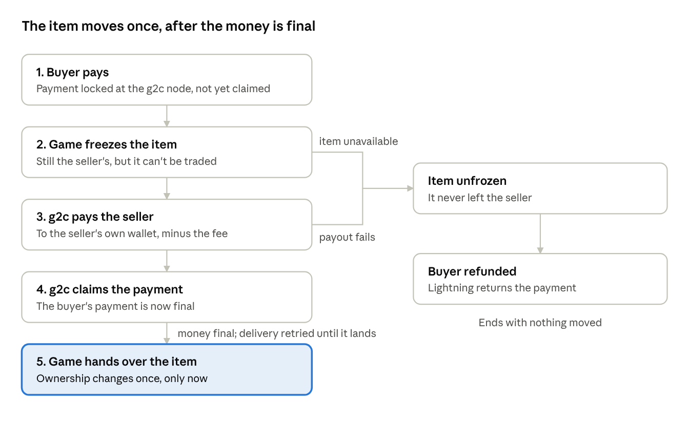
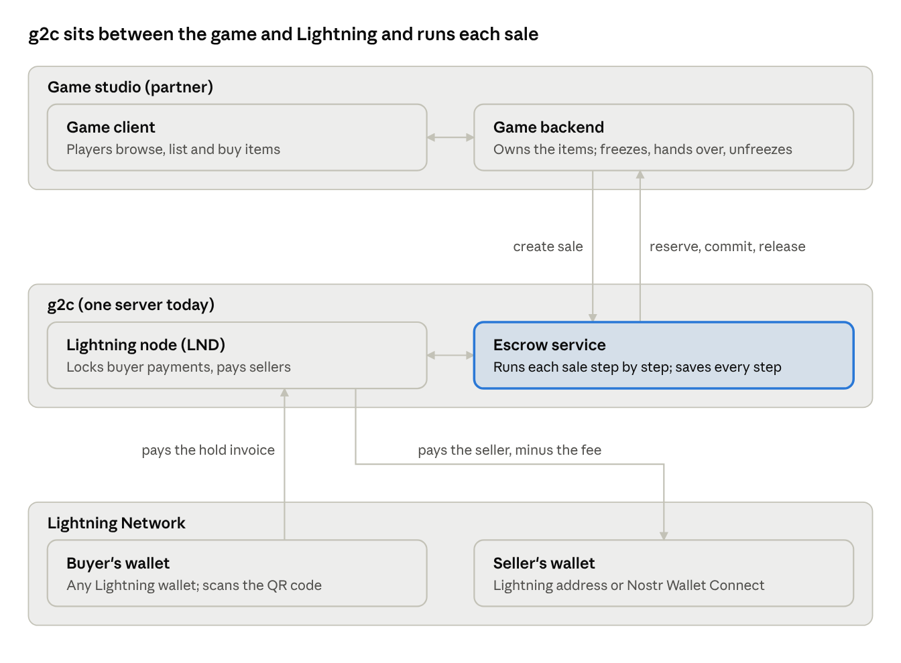

# G2C: safe trading of in-game items for bitcoin

October 2026

G2C is an escrow service that lets players buy and sell in-game items for bitcoin over the Lightning Network, with one guarantee: the buyer's money and the seller's item move together, or neither moves.

## The problem

Players already trade game items for real money, but mostly on grey-market sites where one side always has to trust the other first. Either the buyer pays and hopes the item arrives, or the seller hands over the item and hopes the money follows.

- **Buyers** risk paying for an item that never arrives, or one taken back later.
- **Sellers** risk card chargebacks after the item is gone.
- **Game studios** see the scams, account theft and bots this brings, and earn nothing from the trade. Many ban it outright.

## The service

G2C sits between the game and the Lightning Network and settles each trade as one unit: the item changes owner only once the money is final, and the money is only taken once the item is secured.

| Party | What they get |
| --- | --- |
| Buyer | Pays from any Lightning wallet by scanning a QR code. If the sale fails, Lightning refunds the payment automatically. |
| Seller | Is paid straight to their own wallet (a Lightning address) the moment the sale goes through. No balance to withdraw. |
| Game studio | A safe, in-game market for player trades through a small API, and, as proposed below, a share of each sale. It never handles money. |

G2C keeps no stored balances between sales, but it does control funds during each sale: the buyer's payment locks at G2C's node, only G2C can claim it, and G2C pays the seller from its own funds before claiming it. For the seconds a sale takes, G2C is a custodial intermediary. Its fee is the difference between what the buyer pays and what the seller receives.

## How a trade works

Each trade runs through five steps in a fixed order, from the easiest to undo to the hardest. Nothing irreversible happens until everything before it has succeeded.

The Lightning hold invoice makes this possible: the buyer's payment is locked at G2C's node and can be claimed or returned, but only G2C holds the secret that claims it. If anything fails before the seller is paid, the item is unfrozen and the lock is released, so the buyer gets the payment back automatically.

## Proposed setup

A studio integrates at two points: its backend asks G2C to open a sale, and it answers three calls from G2C that freeze, hand over or unfreeze an item.

G2C runs its own Lightning node, because only the node that receives a payment can hold it before claiming it. Players keep the wallets they already use; the studio never touches money, and G2C never touches items.

## Guarantees

Every failure ends in one of two outcomes: the trade completes, or nothing moved. Only the rare cases where the game itself misbehaves need a person.

| What goes wrong | How it ends |
| --- | --- |
| Buyer never pays | Invoice expires. Nothing moved. |
| Item no longer available | Item stays with the seller, buyer refunded. |
| Game unreachable before the item is frozen | Retried; if the buyer's payment window runs low, buyer refunded. |
| Seller's wallet can't be paid | Retried up to 3 times, then the item is unfrozen and the buyer refunded. |
| Seller payment stuck in the network | G2C waits. It never refunds while a payment may still land. |
| Game unreachable after payment | Delivery is retried until it lands; the money is already final and the item frozen. |
| G2C crashes mid-sale | Resumes from the saved step; every call is safe to repeat. |
| Game refuses to deliver an item that was paid for | Flagged for a person; never refunded automatically. |

Three rules make this hold:

- **Nothing is ever undone.** The item changes owner once, after the money is final.
- **The seller is only paid while the buyer's payment is still locked**, with time to spare. The seller payment is also forced to resolve before the buyer's lock can expire.
- **A refund only happens once the seller payment has definitely failed** and the item is confirmed unfrozen.

## Trust and business model

G2C reduces trust to a few explicit points; it cannot remove it, because item ownership lives in the game's own database.

| Link | How it is secured |
| --- | --- |
| Buyer's wallet to G2C's node | Trust in G2C: Lightning locks the payment at G2C's node, but G2C holds the secret that claims it and could claim it without paying the seller. Only G2C's own rules prevent that. |
| Item ownership | The game, which freezes and hands over items through the contract. |
| Timing of each step | G2C, as coordinator, bound by the rules above. |
| Player to their own wallet app | The wallet provider (often custodial). |

**Revenue.** G2C charges a fee per sale: a fixed base plus a percentage, configured per deployment. The fee is kept as the spread between the buyer's payment and the seller's payout, and the network fee for paying the seller is capped below it, so no sale costs more than it earns.

**Proposed: a studio share.** Splitting part of each sale to the game studio gives studios a reason to integrate rather than ban trading. This is not built yet.

**Potential improvement: G2C never holds the secret.** Instead of creating the secret itself, G2C can reuse the one behind the seller's invoice. It fetches the seller's invoice when the sale is created and issues the buyer a hold invoice with the same hash. G2C then learns the secret only by paying the seller, because a successful Lightning payment returns it to the payer, and only then can it claim the buyer's payment. The buyer and seller do nothing different. G2C could no longer take the buyer's money without paying the seller; the worst it could do is stall until the payment times out and returns to the buyer. That makes G2C look like a Lightning routing node with a condition attached, rather than a custodian. It still fronts the seller payment and takes a fee from the flow, so it reduces the regulatory question rather than removing it. Trade-offs: a failed seller payment can only be retried with the same invoice, and the seller's payout method must work when the sale is created. Not built yet.

## Status and open questions

The design is proven end to end: a real sale has completed on the Bitcoin mainnet with a funded node (on the earlier transfer-then-undo contract), and the full flow runs on a local test network with crash and fault drills.

- **Built:** the escrow service, a demo game with a web app, LND and Core Lightning support, seller payouts by Lightning address, and automated tests for every failure case above.
- **Not yet run:** the Lightning lab drills against the latest reserve-and-commit contract.

Open questions:

- **Regulation.** G2C controls buyers' funds during each sale and takes a fee, which under the EU's MiCA rules likely requires a licence. The options are to get licensed as a custodian, or to adopt the design under Potential improvement first and get a legal opinion on that.
- **Wallet onboarding.** Most gamers have no Lightning wallet. A partner wallet or card on-ramp is needed, with prices shown in euros or dollars.
- **Studio adoption.** Each game must enforce the item freeze everywhere an item can change. That is the main integration cost, and it varies per game.
- **Scale.** Many games, more than one node and server, channel liquidity, monitoring, a ledger, and fraud and anti-money-laundering controls.
